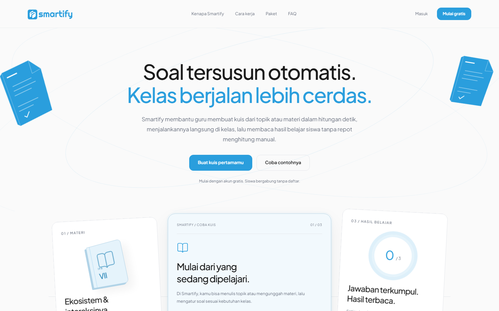
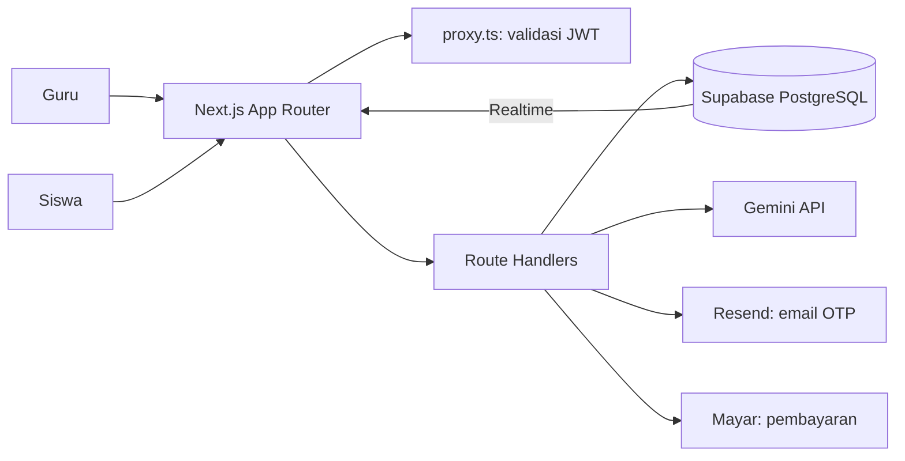

<div align="center">


<h1>Soal tersusun otomatis. Kelas berjalan lebih cerdas.</h1>

<p>
  Platform pembuat kuis berbasis AI untuk guru dan siswa di Indonesia.<br>
  Unggah materi PDF, jalankan kuis langsung di kelas lewat QR code,<br>
  lalu baca hasil belajar siswa tanpa menghitung manual.
</p>

<p>
  <a href="https://nextjs.org"></a>
  <a href="https://react.dev"></a>
  <a href="https://www.typescriptlang.org"></a>
  <a href="https://tailwindcss.com"></a>
  <a href="https://supabase.com"></a>
  <a href="https://ai.google.dev"></a>
</p>

<p>
  <a href="https://smartifyedu.web.id"><b>Live Demo</b></a> ·
  <a href="#cara-kerja">Cara Kerja</a> ·
  <a href="#paket">Paket</a> ·
  <a href="#arsitektur">Arsitektur</a> ·
  <a href="#memulai">Memulai</a> ·
  <a href="#struktur-proyek">Struktur Proyek</a>
</p>

<a href=".github/images/landing-full.png"></a>

</div>

Akun Demo
---------

Coba Smartify langsung di [smartifyedu.web.id](https://smartifyedu.web.id) dengan akun berikut:

| Email | Password |
|---|---|
| `testing@gmail.com` | `testing123` |

Masalah yang Diselesaikan
-------------------------

Menyusun soal, membagikannya, lalu menghitung nilai satu per satu memakan waktu yang seharusnya dipakai untuk mengajar. Guru juga sering baru tahu konsep mana yang belum dipahami siswa setelah ulangan selesai, ketika waktu untuk mengulang sudah terbatas.

Smartify memangkas tiga pekerjaan itu:

- **Menyusun soal:** dari dokumen materi menjadi soal lengkap dengan kunci dan penjelasan.
- **Menjalankan kuis:** siswa bergabung lewat QR code tanpa membuat akun, guru memantau progres langsung.
- **Membaca hasil:** nilai, peringkat, dan analisis topik terkumpul otomatis.

Cara Kerja
----------

| Langkah | Yang dilakukan pengguna | Yang dikerjakan sistem |
|---|---|---|
| 1. Generate | Guru mengunggah PDF materi dan mengatur jenis soal, tingkat kesulitan, jumlah soal, durasi, dan KKM | Gemini mengekstrak soal terstruktur lengkap dengan topik, `concept_tags`, kunci jawaban, dan penjelasan |
| 2. Edit dan publikasi | Guru memeriksa, mengedit soal, lalu mempublikasikan kuis | Sistem memvalidasi kepemilikan kuis sebelum status berubah dari `draft` ke `published` |
| 3. Ruang tunggu | Guru membuka ruang tunggu dan menampilkan QR code | Sistem membuat token sesi unik dan tautan join |
| 4. Bergabung | Siswa memindai QR code dan mengisi nama | Nama divalidasi (2–50 karakter, unik per sesi) dan siswa mendapat token peserta di cookie HTTP-only |
| 5. Mengerjakan | Siswa menjawab soal sampai waktu habis | Timer berbasis server, jawaban tersimpan otomatis, pindah tab dicatat sebagai pelanggaran |
| 6. Hasil | Guru mengakhiri kuis dan membuka hasil | Sistem menilai sisa siswa, menghitung peringkat, dan menyusun analisis kelas |

### Perlindungan selama kuis

- Soal baru dapat diambil setelah guru menekan Mulai.
- Jawaban hanya diterima selama waktu kuis berjalan (toleransi 15 detik), maksimal 500 karakter.
- Pindah tab ke-3 otomatis mengumpulkan kuis siswa tersebut.
- Kunci jawaban dan pembahasan baru dikirim setelah guru mengakhiri kuis.

Paket
-----

| | Free | Premium |
|---|---|---|
| Harga | Rp 0 | Rp 79.000 / 30 hari |
| Batas soal | 20 nomor per hari | 50 nomor per hari |
| Pilihan Ganda | Ya | Ya |
| Isian Singkat dan Campuran | Tidak | Ya |
| Soal tingkat sulit | Tidak | Ya |
| AI Insight analisis kelas | Tidak | Ya |

Batas harian dan fitur per paket didefinisikan di `lib/subscription/plan.ts`. Pembayaran Premium memakai [Mayar](https://mayar.id).

Arsitektur
----------



| Bagian | Tanggung jawab |
|---|---|
| `proxy.ts` | Menjaga rute `/dashboard`, `/generate`, `/quiz`, dan `/payment`; mengarahkan ke login bila JWT tidak valid |
| `app/api/auth/*` | Registrasi dengan OTP, login, Google OAuth, logout, lupa dan reset password |
| `app/api/generate` | Unggah PDF dan ekstraksi soal lewat Gemini |
| `app/api/quiz/[id]/*` | Pengelolaan kuis, ruang tunggu, monitor, akhir sesi, hasil, dan ekspor CSV |
| `app/api/join/[token]/*` | Alur siswa: bergabung, soal, jawaban, pelanggaran, submit, hasil |
| `app/api/ai/classroom-analysis` | AI Insight analisis kelas (Premium) |
| `app/api/payment/*` | Pembuatan invoice Mayar dan simulasi pembayaran untuk development |
| `lib/supabase/server.ts` | Klien Supabase dengan Service Role Key, hanya untuk server (`server-only`) |
| `lib/supabase/client.ts` | Klien Supabase dengan Anon Key, hanya untuk langganan Realtime |

Memulai
-------

### 1. Prasyarat

- Node.js 20 atau lebih baru
- Proyek Supabase
- API key Gemini dan Resend

### 2. Instalasi

```bash
git clone https://github.com/AdrianAnis/Smartify.git
cd Smartify
npm install
```

### 3. Konfigurasi environment

Salin `.env.example` menjadi `.env.local`, lalu isi variabel berikut:

| Variabel | Keterangan |
|---|---|
| `NEXT_PUBLIC_SUPABASE_URL` | URL proyek Supabase |
| `NEXT_PUBLIC_SUPABASE_ANON_KEY` | Anon key, dipakai browser untuk Realtime |
| `SUPABASE_SERVICE_ROLE_KEY` | Service role key, hanya di server |
| `JWT_SECRET` | Secret untuk menandatangani JWT |
| `APP_URL` | URL aplikasi, misalnya `http://localhost:3000` |
| `RESEND_API_KEY` | API key Resend |
| `FROM_EMAIL` | Alamat pengirim email, misalnya `Smartify <noreply@domain-anda.com>` |
| `GEMINI_API_KEY` | API key Gemini untuk generate soal |
| `GEMINI_MODEL` | Opsional, bawaan `gemini-2.5-flash` |
| `API_GEMINI_QUIZ` | Key Gemini yang dipakai fitur analisis kelas |
| `MAYAR_API_KEY` | API key Mayar |
| `MAYAR_API_URL` | Opsional, bawaan `https://api.mayar.club` |
| `GOOGLE_CLIENT_ID` | Client ID Google OAuth |
| `GOOGLE_CLIENT_SECRET` | Client secret Google OAuth |

Jangan pernah meng-commit `.env.local`.

### 4. Siapkan database

Buat proyek di Supabase, lalu siapkan tabel yang dibutuhkan lewat SQL Editor. Bila muncul error `PGRST205` setelah menambah tabel, muat ulang schema cache:

```sql
NOTIFY pgrst, 'reload schema';
```

### 5. Jalankan

```bash
npm run dev
```

Buka [http://localhost:3000](http://localhost:3000).

Perintah
--------

| Perintah | Fungsi |
|---|---|
| `npm run dev` | Menjalankan server development |
| `npm run build` | Build untuk production |
| `npm run start` | Menjalankan hasil build |
| `npm run lint` | Menjalankan ESLint |

Struktur Proyek
---------------

```
app/
├── page.tsx                 landing page
├── auth/                    login, register, verify, forgot dan reset password
├── dashboard/               dashboard guru dan billing
├── generate/                generate kuis dari PDF
├── quiz/[id]/               preview, waiting-room, monitor, result
├── join/[token]/            alur siswa: join, waiting, play, result
├── payment/checkout/        checkout Premium
└── api/                     route handlers
components/
├── landing/                 komponen landing page
├── auth/  dashboard/  classroom/  quiz/  premium/  ui/
lib/
├── auth/                    JWT, sesi, rate limit, Google OAuth
├── quiz/                    generate soal dan tipe data
├── subscription/            paket dan kuota
├── supabase/                klien server dan browser
└── email/                   pengiriman email lewat Resend
proxy.ts                     proteksi rute
```

---

**Smartify** · Precision in Learning.
